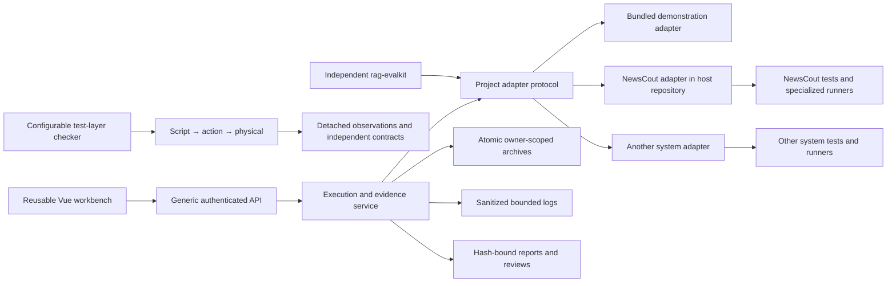

# Adapter-driven testing and QA

The standalone project owns execution and evidence. A host application owns its
business tests, credentials, data access and task implementation. The dependency
direction is host adapter → public workbench contracts; the core never imports a
host or locates its repository.

## Ownership

| Area | Portable project | Host adapter |
|---|---|---|
| Task catalog | Serializable descriptors and JSON schemas | Business task IDs, limits and implementation |
| Identity | Auth callback and owner isolation | Firebase, SSO, token or another identity provider |
| Execution | Explicit start, cancellation, deadline and persistence | Actual test commands, APIs, models and data |
| Evidence | Report hashes, exact row reviews, import provenance | Source evidence and interpretation of business checks |
| UI | Generic task workspace and shared panels | Branding, session, taxonomy and project extensions |
| Tests | Configurable layer checker, observations and template | Business scenarios and physical adapters |

## Compatibility boundary

NewsCout imports the extracted log, report-publication, archive and source-identity
implementations. Its former module paths are bindings to those implementations,
so existing routes and their tests retain one authoritative implementation.
Specialized retrieval, model and real-corpus runners stay in the NewsCout adapter.
The generic `/qa/workbench` API schedules them through `ProjectAdapter.execute`.

The older project-specific panels are supplied as reusable UI components; their
project protocol is an adapter capability. The standalone task workspace accepts
arbitrary task IDs and schemas and does not require those specialized protocols.

The frontend separates presentation from execution state. `App.vue` composes
task settings, run evidence/review, history and health views;
`useWorkbench` owns their generic API lifecycle. `QaValidationPanel` and
`QaLiveEvaluationPanel` render their existing panel contracts through
`useValidationRun` and `useLiveEvaluation`. Each composable owns its cancellation
signal, timers and observations per instance. Requests can be injected for
independent lifecycle tests; no shared execution singleton or common retry policy
is imposed on the different protocols.

## Evidence rules

GET requests and task selection cannot execute a task. Paid task descriptors have
an explicit budget ceiling; each start requires cost acknowledgement and a budget.
Adapters remain responsible for provider request/token limits and their real cost
ledger. A platform deadline stops waiting and requests cancellation; adapters must
cancel their subprocesses or cooperate with the cancellation event.

Execution completion, structural checks and human semantic review are separate.
Reports retain the source SHA captured for the run. Review decisions bind to the
exact report and row hashes, with a named reviewer and evidence-based reason.
Imported reports remain historical evidence. Reading or restoring an interrupted
checkpoint never resumes paid work. Synthetic examples cannot certify quality.

The checker enforces structure, not the meaning of a scenario or an arbitrary
Python security sandbox. Code review still owns assertion quality, adapter
substitutability and correspondence between fixtures and real protocols.
